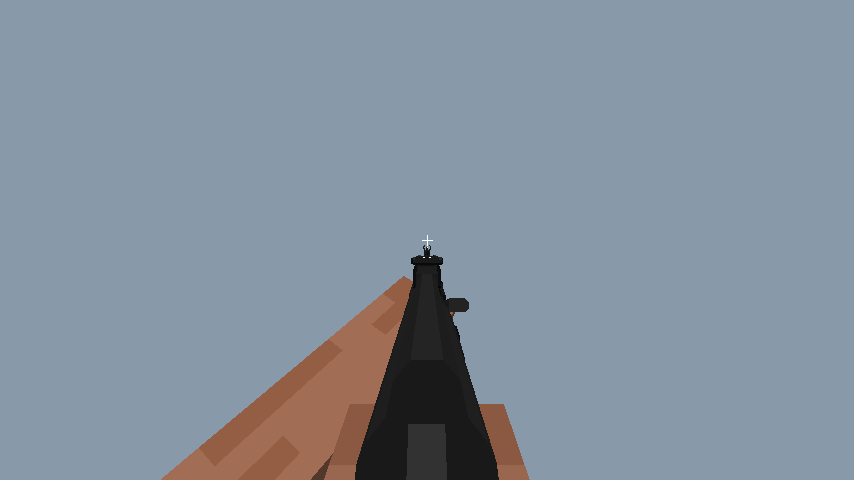
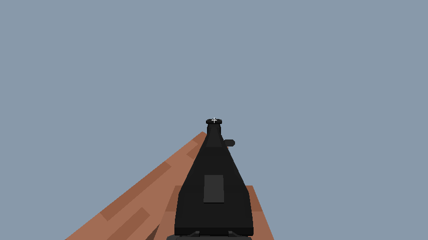

# AK74M 瞄准位置修复

日期：2026-10-04。用户反馈：瞄准时的位置与 1.7.10 对不上。

## 原因与改动

移植版第一人称已采用 FMUM 姿势链，但 ADS 归心一直使用枪体 AimCenter。实际 1.7.10 的 FlansModClient.tick 会先查当前使用的瞄具，再用 getAimCenterOfSightAt 求出瞄具在整枪上的瞄点；只有没有瞄具时才回退枪体。

AK74M 默认安装 6P1Sb2AK74Rearsight。第 5 号安装槽高度为 `31/16 × 0.2 = 0.3875`，照门自身 AimCenter 为 `1/16 × 0.2 = 0.0125`，两者相加得到 **0.4 格**。枪体原值为 **0.4375 格**；误用它会在 ADS 时把枪与双臂压低。

新增 LegacySightPose，与运行时绘制的默认附件树一致，按旧版的倒序遍历、首组瞄准线与 X 排序规则选择瞄具；累计嵌套安装槽的旋转后求 Y/Z 瞄点及绕 X 的归心角度。FmumFirstPersonPose 使用这个瞄点执行原有 ADS 变换，枪体数值不改。

依据为本地 FMUM-1710-master 的 ModifiableType.recordSights、GunType.setSightsAtForGun / getAimCenterOfSightAt、FlansModClient.tick，并已核对 EFT 配套核心 jar 的相应字节码。没有加入按截图猜出的位移或缩放常数。

## 同一条件的前后对照

均为 AK74M、完整默认附件、默认 Steve 皮肤、ADS=1、FOV 70°、854×480，零冲刺/换弹/后坐力。纯离线预览，无世界光照；与用户截图中的皮肤和天气不同。

修复前：按枪体瞄点归心。

修复后：按默认照门瞄点归心。

离线预览器同时修正了定义读取顺序：枪定义必须在附件定义之后读取，才能保留完整默认附件。两张对照图均使用修正后的同一读取流程，比较的唯一姿势参数差异是归心瞄点。

## 验证与边界

编译通过。验证涵盖无瞄具回退、嵌套斜置安装槽、多瞄准线的首组选择，以及 31 把 EFT 枪的 ADS 数值有效性；原有第三人称、手臂网格和 UV 检查继续通过。

AK74M 照门实际挂载瞄点 `(0.5125,0.4,0)` 的眼空间坐标为 `(0.000169,0.000177,-0.500276)`，投影到 NDC `(0.000270,0.000504)`，距离画面中心约 **0.17 像素**。这验证默认照门归心，并不等同于所有枪的实机验收。

本次未调整 FOV。1.7.10 核心会使用原版设置中的 FOV，而现代手持物品投影默认采用 70°；用户原版截图的 FOV 设置尚未确认，因此不将两张不同游戏截图的像素尺寸直接视为缩放参数依据。

当前只处理实际已绘制的默认附件树；可变附件状态、手动切换瞄具及切换平滑仍待移植。未启动游戏或注入桌面输入。用户需重启修复版后，站定持 AK74M 检查 ADS 的照门高度及枪身位置。

复现：在工程根目录执行 `./tools/offline/RunEftAudit.ps1`，自动生成本报告所用的前后预览与 [verification.log](verification.log)。

改前备份：`E:\JAVAMCMODGJ\FLAN 移植i\BACKUP_before_ads_attachment_center_20261004_025244`。
