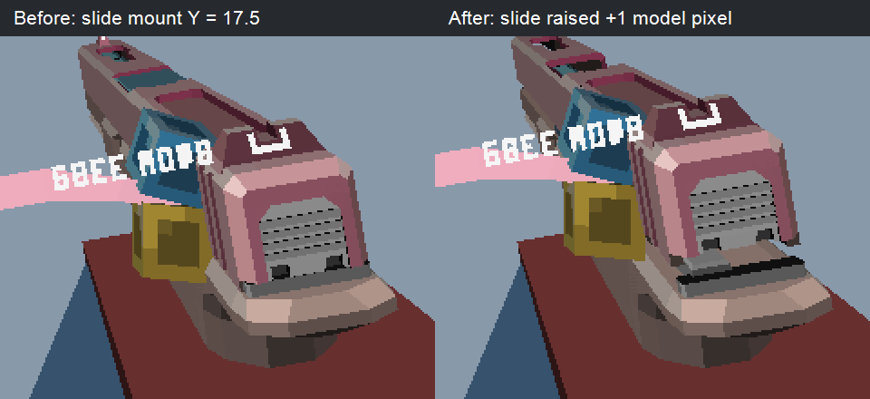

# Bocchi 滑套高度微调

**后续更正（2026-10-18）：此处记录的 +1 像素调整已撤回。** 用户指出改枪侧视预览中滑套悬空，对比 Y=18.5 / 18.0 / 17.5 的实际模型后，确认额外上移造成接合间隙。当前枪定义与可复制 TXT 已恢复 `AttachPoints 0 17.5 0 0 0 0 29 14.5 0`，保留 0.4.1 / 0.4.2 中模型读取顺序修复。下文及图片为历史调整记录，不是当前配置。

用户明确“太靠下，需要往上面来一点”，并圈出枪尾粉色滑套和灰色后盖。2026-10-18 在本工程安装的枪定义 `run/flan/EscapeFromTarcraftReforged_1.5.3/guns/BocchiTheGlock18C.txt` 中进行局部外观调整。

仅将一行配置从 `AttachPoints 0 17.5 0 0 0 0 29 14.5 0` 改为 `AttachPoints 0 18.5 0 0 1 0 29 14.5 0`。滑套所在第 0 槽上移 1 个模型像素（缩放 0.2 下为 0.0125 格），第 1 槽的 Crossline 瞄准定位上移相同距离。保留 X/Z、后续附件槽、旋转和滑套运动行程。修改按字节保留原编码和换行；回退此行即可恢复上次高度。

这是依照用户偏好微调已安装内容包，不是重新判定原作者模型有错。0.4.1 的构造顺序修复继续保留；本次不需要重新编译 JAR。

实际模型/贴图的静止、ADS、拉栓三个场景各生成调整前后预览。`VerifyLegacyRender`、`VerifyReloadRendering` 回归通过；选定瞄准线 Y 从 0.2875 调到 0.3000。预览为离线 CPU 渲染，实机待重启内容加载后确认。

原文件备份：`E:/JAVAMCMODGJ/FLAN 移植i/BACKUP_bocchi_slide_height_20261018_210013/BocchiTheGlock18C-before.txt`。

单独可复制的更新文件：`build/patches/bocchi-slide-height/BocchiTheGlock18C.txt`。它应替换对应内容包 `guns` 目录内的同名定义；工程 `run/flan` 已更新，其他游戏目录需同步这一文件。不要把此 TXT 当作独立内容包安装。

