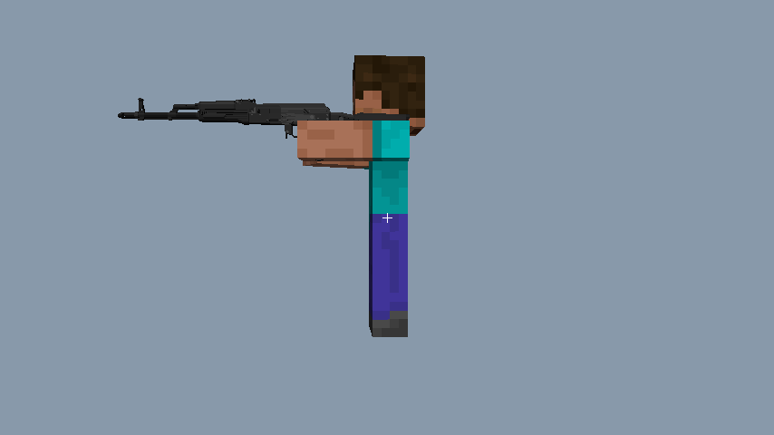
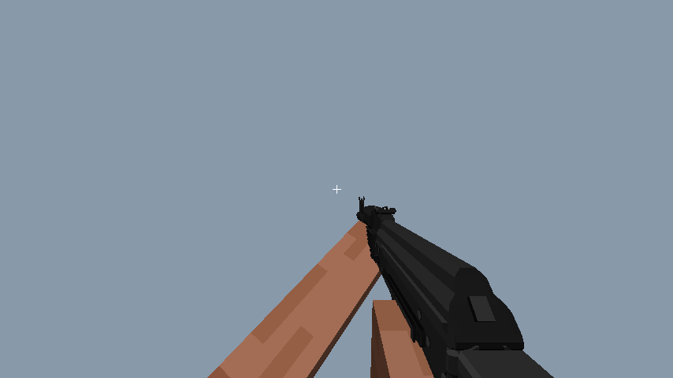

# EFT 姿势修复与验证记录

日期：2026-10-04（Asia/Shanghai）。基准为 FMUM 1.7.10 源码、EFT 自带 FMUM 1.1 Modified 核心 jar 和用户提供的 1.7.10 截图。

## 当前结论

第一人称已整体采用 FMUM 姿势链；第三人称收到用户验收反馈后，补回完整的 1.7.10 持枪链及双臂抬起姿势。随后用户指出 ADS 位置仍与 1.7.10 不符，本次补回默认附件照门的瞄点选择，详见 [ADS 位置对照](ADS位置对照.md)。编译和离线检查通过。**新版 ADS 与第三人称实机验收尚待用户反馈，不能据离线预览宣称通过。**

未启动游戏，未模拟键盘/鼠标，也未调用现有自动装包、换弹或开火调试套件。用户提供的截图和运行日志均只读核对。

## 第三人称问题与修复

验收图显示枪垂在角色身侧，1.7.10 参照图显示双臂抬起持枪。实际源码原先先应用 FMU 2.0 的 `Ry(90) · T(-.08,-.12,0)`，再叠加旧版 RenderGun EQUIPPED，且 thirdPersonOffset 应用两次。角色物品扩展没有声明双手持枪姿势。

EFT 核心 `FlansModClient.tick()` 字节码 266..343 确认：持枪玩家在第三人称持续 `setItemInUse(stack,100)`；GunType 默认动作是 bow。现在用 NeoForge `IClientItemExtensions.getArmPose` 的 BOW_AND_ARROW 恢复相同的视觉姿势，不调用 startUsingItem，不修改射击/使用状态。EFT 31 把枪均验证得到抬臂姿势，弹匣排除；冲刺时恢复普通手持姿势。姿势随头部方向转动，皮肤袖子和护甲继续使用原版模型链。

枪的变换先对消现代 ItemInHandLayer（在手臂之后），然后恢复下列旧链。玩家右臂变换由原版模型提供：

```text
现代外层：Rx(-90) · Ry(180) · T(1/16,.125,-.625)
对消：    T(-1/16,-.125,.625) · Ry(180) · Rx(90)

旧 RenderPlayer：T(-1/16,7/16,1/16) · T(0,.1875,0)
                 · S(.625,-.625,.625) · Rx(-100) · Ry(45)
Forge helper=false：T(0,-.3,0) · S(1.5) · Ry(50) · Rz(335)
                    · T(-.9375,-.0625,0)
FMUM EQUIPPED：Rz(35) · Ry(-5) · T(.75,-.22,-.08)
               · S(1,1,-1) · T(thirdPersonOffset)
```

Minecraft 1.7.10 原版 RenderPlayer（本地 `mc1710.jar` 的 bop）字节码 858..1161 确认旧手偏移和 full3D 链；弓专用物品分支判定 Items.bow 本身，不能因为角色使用弓箭姿势就把枪当弓。EFT RenderGun 的 EQUIPPED 分支和源码一致。Forge 前置链见[官方 Forge 1.7.10 源码](https://github.com/MinecraftForge/MinecraftForge/blob/1.7.10/src/main/java/net/minecraftforge/client/ForgeHooksClient.java#L196-L217)。

验证将“现代外层 × 新转换 × 模型偏移”逐项与完整旧链比较，16 个矩阵分量误差均小于 1e-5；使用非零模型偏移检查不会再次重复应用。右手两次镜像互相抵消，左手单独反转绕序。EFT 验收仍以右手为主。

静态侧面预览（经典宽臂 Steve 比例、默认附件；不代替实际玩家动画）：



[正面](AK74M_third_front.png) · [背面](AK74M_third_back.png) · [抬头](AK74M_third_up.png) · [低头](AK74M_third_down.png)

## 第一人称修复

采用共享的 FmumFirstPersonPose，使运行时与离线预览使用同一 itemFrame、静止、ADS、冲刺、换弹数据混合与 ADS 归心。固定开头的半块位移对消保留。发现并补齐两项交接链的遗漏：Forge helper=false 前置链，以及 ADS 绕 AimCenter 旋转后的撤销平移。AimCenter 另补可选 X 角度解析，Y/Z 原有单位与缩放语义保持。

手臂外层仍为 `T(pos) · Rx · Ry · Rz · S(scale)`，1/16 网格置于枪 modelScale 之外。EFTArm 的两个 SRG 局部旋转原先未被提取；读取实际核心/模型后补上 X=-90°、Y=90°，烘焙网格 X 范围为 [-11/16,1/16]。64×32 → 64×64 玩家皮肤仍只对 V 乘 0.5。

| AK74M 离线状态 | 枪可见像素 | 左臂可见像素 | 右臂可见像素 | 结论 |
|---|---:|---:|---:|---|
| 静止 | 24853 | 18361 | 5487 | 枪和双臂在视锥内 |
| ADS=1 | 25297 | 20125 | 5198 | 枪和双臂在视锥内；默认照门的实际挂载瞄点投影接近中心 |
| 后坐力=1 | 32898 | 19620 | 2648 | 静态后坐力采样可见；动作方向待实机确认 |
| 换弹姿势权重=1 | 24947 | 28708 | 527 | 两臂可见；完整逐帧换弹/弹匣轨迹未由此验证 |
| 冲刺权重=1 | 0 | 0 | 0 | 原包冲刺向量在本离线链终点全部离开视锥，缺少 1.7.10 同状态参照，列为待核对 |

AK74M 默认照门 `6P1Sb2AK74Rearsight` 的局部瞄点为 `(0.5125,0.4,0)`，归心后眼空间为 `(0.000169,0.000177,-0.500276)`，NDC 为 `(0.000270,0.000504)`。在 854×480、FOV 70° 的离线投影中，距离画面中心约 0.17 像素。枪体 AimCenter 保留 `0.4375`，只有无瞄具时回退使用。

默认瞄具选择按 1.7.10 的 recordSights / setSightsAtForGun / getAimCenterOfSightAt：倒序遍历挂载槽及附件，选择首个 Y/Z 瞄准线组，再按 X 从大到小选取瞄具；嵌套安装槽的 X 轴旋转参与位置与瞄点计算。回退、嵌套斜置和多瞄具选择的针对性检查通过。当前运行时绘制的是默认附件树，尚未接入可变附件状态与手动切换瞄具状态。

离线预览器此前直接遍历 TypeFile 的 HashMap，读取枪的顺序可能早于附件，导致解析器丢弃默认附件。本次改用 OfflinePack 的固定类别读取顺序并重新生成全部预览；游戏渲染器的默认附件读取顺序未因此改动。上表现为正确安装附件后的结果。



[ADS](AK74M_ads.png) · [冲刺终点](AK74M_sprint.png) · [换弹](AK74M_reload.png) · [后坐力](AK74M_recoil.png)

2026-10-04 后续已接入 takeOut、checkAmmo、checkChamber、视角跟随和 rest 基础链，详细行为与待验收项见 [FMUM 动作补齐](FMUM动作补齐.md)。枪托距离经实际核心字节码核对为固定零位，保持零。附件指定左右手姿势优先级与手动切换瞄具的完整状态仍未扩展。默认 RunPoseTime 已按核心恢复为 6 tick；现有射击后 20 tick 冲刺姿势抑制保留。诊断探针仍默认关闭。

## 材质审计及复现

完整结果见[材质审计报告](materials/材质审计报告.md)：477 条记录，修复后高置信异常 0 条，9 条待复核。模型数组内各 renderer 的 UV 偏移互相覆盖已修复；原包材质文件未修改，AK74M 黑色设计保留。额外将皮肤尺寸修正日志改为每个模型/材质组合只报告一次，避免每帧重复打印。

工具现在保存在 `tools/offline`，输出保存于 `reports/eft`，不会随 Gradle clean 删除。可复现命令（仅离线，不运行游戏）：

```powershell
./tools/offline/RunEftAudit.ps1
```

脚本通过 writeOfflineClasspath 导出工程依赖，编译离线工具，再执行针对性验证、全包材质审计、第一人称及第三人称预览。可传 `-OriginalPack <原包解包目录>`。`tools/offline/stubs/com/flansmod/common/FlansMod.java` 仅避免离线启动 NeoForge 注册器，编译到 build/offline，**不进入游戏 sourceSets 或发布 jar**；实际定义读取、字节码提取、几何烘焙和材质路径仍使用工程代码。

结果日志见 [verification.log](verification.log) 与 [material_audit.log](material_audit.log)。最后一次完整脚本执行通过。

改前备份：

- `E:\JAVAMCMODGJ\FLAN 移植i\BACKUP_before_fmum_fp_material_20261004_003249`
- `E:\JAVAMCMODGJ\FLAN 移植i\BACKUP_before_legacy_third_person_20261004_012229`
- `E:\JAVAMCMODGJ\FLAN 移植i\BACKUP_before_ads_attachment_center_20261004_025244`
- `E:\JAVAMCMODGJ\FLAN 移植i\BACKUP_before_fmum_actions_20261004_135700`

收到修复后的新版 ADS 与第三人称反馈前，状态保持“编译/离线通过，实机待验收”。
