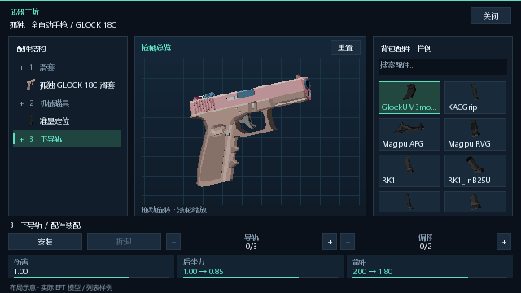

# 改枪界面与数据修复 0.4.2

工程：`E:\JAVAMCMODGJ\FLAN 移植i\flanmod-template-1.21.1`。日期：2026-10-18。

原移植仅渲染所有同型号枪共用的默认配件，没有改枪入口、安装请求或按单件保存的装配。本版持枪按 I 打开服务端菜单，支持配件树、嵌套空槽位、背包实际配件卡片和搜索、旋转/缩放整枪、安装预览与伤害倍率/纵向后坐力/腰射散布比较。窄屏以“结构/背包”标签切换。

每把枪通过 CustomData 保存配件树和修订号。缺少数据沿用内容包默认树；显式空树保持裸枪。装配视图浅复制只读定义并替换配件树，保留原定义身份，不执行构造注册、不改其他同型号枪。模型、瞄准、握持、有效伤害/弹速/后坐力/散布、枪长、取出时间、声音和枪口特效读取实际装配。

安装使用背包真实物品并只消耗一件；拆卸以保留子配件的整组件返还（区别于旧 FMUM 拆散为多件），保存原物品组件、子件安装位置和涂装索引。背包满时拒绝拆卸。服务端验证菜单 ID、当前菜单、原枪栈身份、选中槽、修订号、路径、兼容列表、槽容量、导轨步数和偏移范围；拒绝无效操作时不改枪、不扣配件。子树最多 8 层、256 件，网络路径解码限 16 个整数。重复错误也同步响应计数。

按原 FMUM 规则执行名称白名单→名称黑名单→非空类型白名单→类型黑名单；类型使用 AttachmentType 标签，不误用 ItsType。NeededToShoot/Auto/Charge 逐层检查直接子件并按多重集消耗需求；缺自动循环能力时射后留壳、不自动供弹。修订同步会让两侧重新计算取出时间，避免只有服务端刷新动作。

验证：Java 21 从最终发布 JAR 运行 VerifyGunModification，64 项断言通过，包含真实 EFT 拆装/存取、同型号隔离、后坐力与 ADS、嵌套组件与元数据、数量守恒、过期/错误请求和背包满拒绝、导轨边界、原版允许规则、逐层需求、留壳供弹、网络往返与超长路径解码拒绝。9 项既有离线回归通过：模型变换、默认渲染、持握、换弹、动作、后坐力、枪口效果、弹药保存、声音。既有工具编译版本使用 Java 25 执行；新数据验证和生产字节码为 Java 21。

完整 Gradle offline build 通过；工程没有 Gradle JUnit 测试源，test 为 NO-SOURCE。最终产物信息见 `gun-modification/artifact-verification.json`，验证日志均在同目录。未启动、关闭或控制游戏，实际 OpenGL 界面、真实点击及专用服务器联机仍未运行验证。

用户指出布局图滑套悬空后，追加三高度真实模型比较：额外上移到 Y=18.5 造成间隙，已将运行内容包与 `build/patches/bocchi-slide-height/BocchiTheGlock18C.txt` 恢复原包滑套 Y=17.5、瞄准 Y=0，保留读取器修复。三张布局图已按纠正后的内容包重新生成。其为 CPU 布局示意，候选库存为样例，不能作为实机截图。

源码/JAR 修改前备份：`E:\JAVAMCMODGJ\FLAN 移植i\BACKUP_flan_before_modify_20261018_211157`。未改其他工程，未提交 Git。DeepSeek 任务见 COLLABORATION.md；截至本记录尚无 DeepSeek 回执，独立规则复核来自当前 Codex 子代理，不冒充 DeepSeek。

