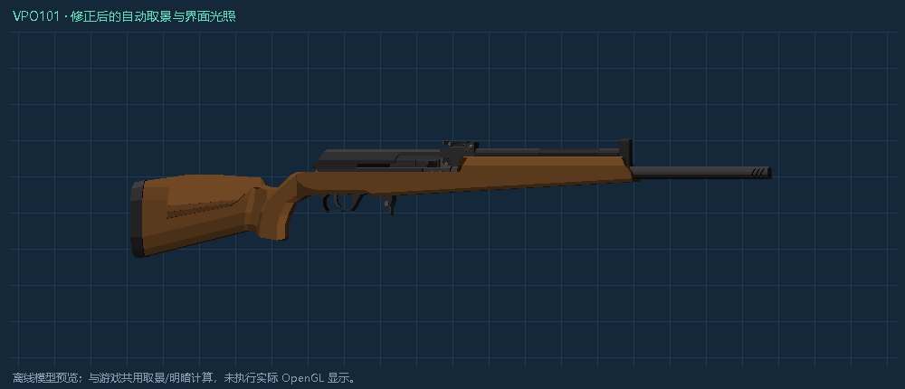

# 改枪预览与配件目录 0.4.3

用户实机截图：Vepr Hunter / VPO-101 在改枪界面显示偏小、偏暗，要求右侧增加“是否显示此枪可用配件”。目标始终为 flanmod-template-1.21.1。

预览原先用三维包围球直径限制长枪缩放，即使横向空间足够，也受面板高度限制。现在对枪体、实际嵌套配件和弹匣的旋转后轮廓求界，按可见宽高居中缩放；复位回水平视角，保留拖动和滚轮缩放。VPO101 在 510 宽测试视口占 448.8，旧比例尺 92.78，新比例尺 174.28。

界面独立提交网格：法线随姿态变换，以有环境底光的面着色配合 emissive 渲染，不使用场景方向光压暗预览。只改变改枪界面绘制，没有改世界渲染器或枪械持握。实际光影模组下的 OpenGL 呈现仍需实机确认，离线图不能冒充游戏截图。

右侧开关默认关闭。开启后，按左侧当前选中挂点列出直接兼容配件（包含缺少配件），显示拥有数量、缺少及槽满状态。缺少件可查看安装效果与属性比较，不能发起真实安装。满槽可预览替换，预览只修改复制树；实际操作仍须先拆卸。拥有的配件安装时继续读取真实库存并由服务端验证。需经适配器的附件在适配器挂点查看，不误报为根枪直接兼容。

目录按挂点缓存，缺少件图标缓存，候选 ID 区分类型与来源。小屏采用紧凑列表，保留搜索和勾选行。

完整 offline build 成功；Gradle JUnit 为 NO-SOURCE。Java 21 从最终 flansmod-0.4.3.jar 执行：VerifyGunModificationView 17842 项（31 把枪、3 种视口、4 组角度和实际顶点法线/颜色）、VerifyGunAttachmentCatalog 4382 项（实际 EFT 342 挂点）、VerifyGunModification 64 项均通过。日志与产物 SHA256、Java 字节码校验见 `gunsmith-0.4.3/`。未启动游戏或模拟桌面输入。

